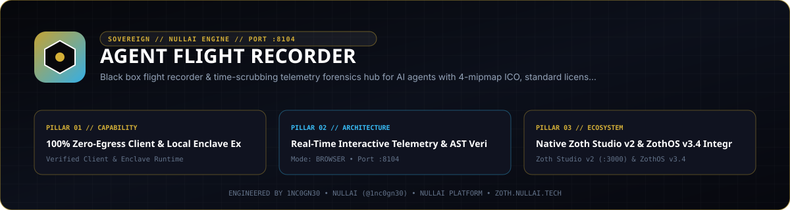
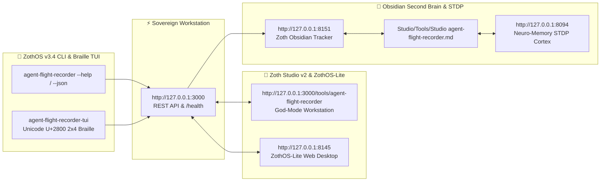

<div align="center">
  
</div>

<br />

# Agent Flight Recorder ⚡

[](pyproject.toml)
[](https://www.python.org/)
[](LICENSE)
[](https://nullai.tech)
[](https://github.com/1nc0gn30/agent-flight-recorder)

**Autonomous Black Box Flight Recorder & Time-Scrubbing Telemetry Forensics Hub for AI Agents.**

Captures high-resolution session timelines and provides an interactive in-browser scrubber (like a digital audio workstation or video editor) that allows developers to replay an agent's execution second-by-second with synchronized terminal stream, network graph, memory engrams, and single-file offline bundles.

---

## 💎 What It Does

When an autonomous AI agent fails, hallucinates, or violates security policies in production or CI/CD, post-mortem debugging is notoriously difficult:
1. **Opaque Multi-Agent Interactions**: Actions happen across distributed subagents, tools, and background processes with uncoordinated logs.
2. **Missing State Snapshots**: Developers cannot see what the agent's memory looked like or what network requests were inflight at the exact second a failure occurred.
3. **Complex Incident Sharing**: Exporting an incident requires sharing credentials, spinning up databases, or sending massive text logs.

**AGENT FLIGHT RECORDER** acts as an avionics-grade black box. It records all agent events with millisecond timestamps into a local SQLite database, provides a timeline scrubber that reconstructs the terminal stream, memory state, and network connections at any offset, and exports single-file standalone HTML replay bundles that work offline in any browser.

---

## 🏛️ How It Works: Time-Scrubbing Black Box Architecture

```text
    ┌─────────────────────────────────────────────────────────┐
    │             ● AGENT FLIGHT RECORDER (PORT 8104)         │
    │                                                         │
    │   ┌───────────────────────┐   ┌─────────────────────┐   │
    │   │  TIME-SCRUB FORENSICS │   │   SQLITE STORAGE    │   │
    │   │  • Microsec Snapshots │   │  • Session Metadata │   │
    │   │  • Terminal Stream    │   │  • Timeline Events  │   │
    │   │  • Memory Engrams     │   │  • Merkle Ledgers   │   │
    │   └───────────────────────┘   └─────────────────────┘   │
    │               ▲                          ▲              │
    │               │                          │              │
    └───────────────┼──────────────────────────┼──────────────┘
                    │                          │
           Ingested Flight Events     Exported Standalone Bundle
                    │                          │
        ┌───────────────────────┐   ┌─────────────────────┐
        │   AUTONOMOUS AGENT    │   │ SINGLE-FILE HTML    │
        │   pytest / CI Runner  │   │ Offline Incident    │
        └───────────────────────┘   └─────────────────────┘
```

1. **Multi-Source Forensic Telemetry**: Ingests millisecond events from Prompt Firewall (:8098), Egress Sentinel (:8095), Mock Twin (:8097), Neuro-Memory (:8094), and child subprocess stdout/stderr.
2. **Deterministic Time-Scrubbing Scrubber**: Replays the state at any millisecond offset $t$, displaying stdout lines emitted up to $t$, active network connections, and recalled associative memory engrams.
3. **Voice Incident Briefing**: Automatically synthesizes human-readable mission debriefings ready for Kokoro TTS (:9394).
4. **Single-File Incident Exporter**: Compiles the entire session into a standalone, zero-dependency HTML file with embedded JSON telemetry for offline sharing.

---

## 🚀 Quickstart & Standalone Server

`agent-flight-recorder` runs with **zero pip packages** on standard Python 3.10+.

```bash
# Clone the repository
git clone https://github.com/1nc0gn30/agent-flight-recorder.git
cd agent-flight-recorder

# Start the Flight Deck UI and forensics server
python3 server.py --port 8104
```

- **Flight Deck Cockpit**: `http://localhost:8104/`
- **Health Check**: `http://localhost:8104/health`
- **Sessions API**: `http://localhost:8104/api/sessions`
- **Stats API**: `http://localhost:8104/api/stats`

---

## 🛠️ ZothOS CLI & Subcommands

The tool is pre-installed across ZothOS as `agent-flight-recorder` and `agent-flight`:

```bash
# Check status and telemetry
agent-flight-recorder --status
agent-flight-recorder --json

# Record an agent execution session
agent-flight record -- python3 my_agent.py

# Launch the Flight Deck Cockpit UI
agent-flight serve --port 8104

# Export a standalone single-file incident bundle
agent-flight export flt-9dd3f49230 -o incident_bundle.html

# Summarize flight telemetry storage
agent-flight status
```

---

## 🌐 Telemetry & REST API

| Endpoint | Method | Description |
| :--- | :---: | :--- |
| `/health` | `GET` | Health check endpoint returning status, version, and port |
| `/api/sessions` | `GET` | Lists recent recorded flight sessions |
| `/api/session/<id>` | `GET` | Fetches metadata and duration for a session |
| `/api/timeline/<id>` | `GET` | Returns all millisecond-precision forensic events |
| `/api/scrub/<id>?offset_ms=N` | `GET` | Computes state snapshot at offset N ms |
| `/api/briefing/<id>` | `GET` | Generates text briefing for Kokoro TTS |
| `/api/export/bundle?session_id=<id>` | `GET` | Downloads standalone single-file HTML replay bundle |
| `/api/ingest` | `POST` | Ingests forensic telemetry events from external tools |
| `/api/stream` | `GET` | Server-Sent Events (SSE) live telemetry stream |

---

## ☕ 100% Free & Open-Access Support Architecture

Agent Flight Recorder is **100% free, unlocked, and open-access by default**. There are zero paywalls, zero blurred locks, zero license modals, and zero subscription gates.

If you find this utility valuable, support sovereign open-source engineering:
- **☕ Buy Us a Coffee via Stripe**: [https://buy.stripe.com/3cIfZg27PdKo2D64Ocfw40X](https://buy.stripe.com/3cIfZg27PdKo2D64Ocfw40X)
- **◎ Solana Tip Address**: `GG2eQbVh8ut1BK6j1A2tz7pSySdLpD38BgyEhGcxdXoK`

---

## 🔒 Network Exposure & Security

The server binds to `127.0.0.1` by default. To reach it from other devices, opt in explicitly with `--host 0.0.0.0` and only on a trusted network. Browser requests are only accepted from `localhost` / `127.0.0.1` pages: cross-site POSTs get `403` and CORS never answers `*`.

---

## 📜 Attribution & License

- **Engineered by**: 1nc0gn30 • NullAI ([@1nc0gn30](https://github.com/1nc0gn30)) • [NullAI Platform](https://nullai.tech)
- **License**: MIT License

---

## 🏛️ ZothOS v3.4, Zoth Studio v2 & Obsidian Second Brain Ecosystem



### Cross-Surface Integration Matrix

| Surface | Endpoint / Binary | Capabilities |
| :--- | :--- | :--- |
| **Standalone Workstation** | `http://127.0.0.1:3000` | 100% Free & Open-Access Web Deck, live `/health` & REST telemetry |
| **Zoth Studio v2 Route** | `http://127.0.0.1:3000/tools/agent-flight-recorder` | Interactive God-Mode component inside Zoth Studio (`https://zoth.nullai.tech`) |
| **ZothOS v3.4 CLI & TUI** | `agent-flight-recorder` / `agent-flight-recorder-tui` | Global binary in `/usr/local/bin/` with Unicode `U+2800` Braille TUI & `--json` output |
| **ZothOS-Lite Web Desktop** | `http://127.0.0.1:8145` | Browser-native KDE-style window manager & terminal launcher |
| **Zoth Obsidian Tracker** | `http://127.0.0.1:8151` | Interactive Obsidian Second Brain vault explorer (`~/Documents/Obsidian Vault/Studio/Tools/Studio agent-flight-recorder.md`) |
| **Neuro-Memory STDP Cortex** | `http://127.0.0.1:8094` | 3-Factor STDP synaptic memory daemon & 21-tool MCP server |

```bash
# Inspect CLI & Unicode U+2800 Braille TUI on ZothOS v3.4
agent-flight-recorder --help
agent-flight-recorder-tui --status
agent-flight-recorder-tui --json

# Verify Second Brain Vault & 12-Step Verification Gallery on :8151
zoth-obsidian-tracker --verify
```

